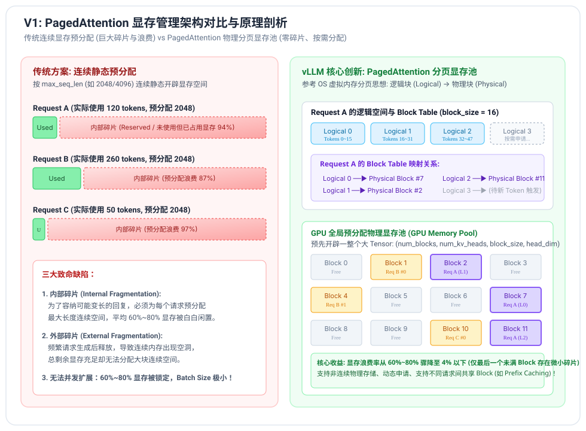
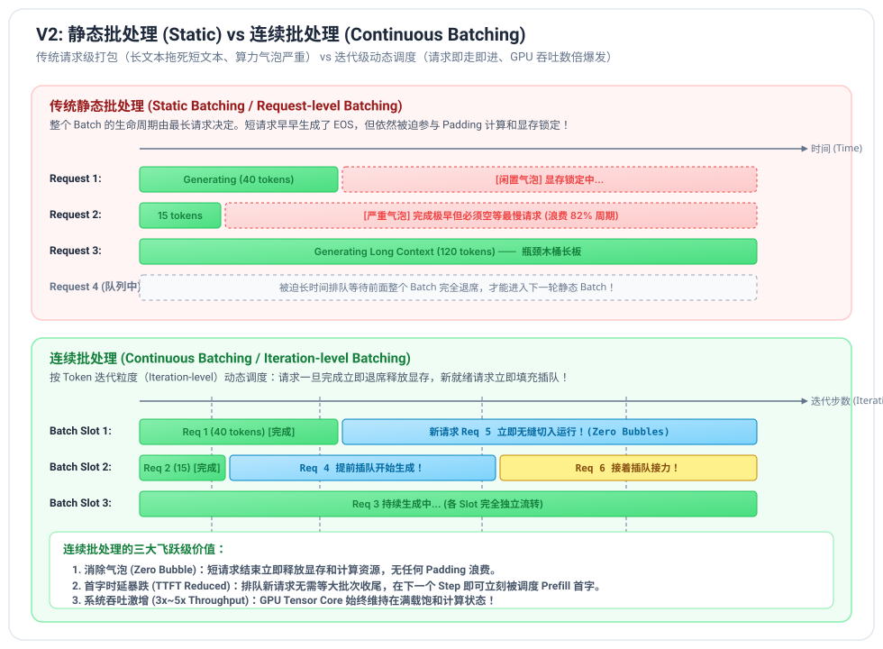

# Toy-vLLM: 从零构建高性能大模型推理引擎

[](https://www.python.org/)
[](https://pytorch.org/)
[](https://github.com/triton-lang/triton)
[](https://developer.nvidia.com/cuda-toolkit)
[](tests/)
[](ROADMAP.md)
[](LICENSE)

**Toy-vLLM** 是一个参考工业级 SOTA 推理引擎（vLLM、SGLang、Orca、Megatron-LM）设计理念，采用**循序渐进、版本迭代驱动（V0 -> V5）**方式从零构建的大模型推理系统。

本项目拒绝调用黑盒推理框架，从底层 PyTorch 张量与 Triton 原生内核出发，完整还原了**分页显存池（PagedAttention）**、**连续批处理（Continuous Batching）**、**算子深度融合与 CUDA Graph 捕获**、**Megatron-LM 风格单机多卡张量并行（TP）**以及**稀疏混合专家模型与专家并行（MoE & EP）**的全部算法与工程细节。

---

## 核心架构概览

### 1. PagedAttention 分页显存池与寻址流
参考现代操作系统的虚拟内存分页机制，将序列逻辑空间按固定大小 Block 划分，彻底消灭传统连续显存预分配导致的内部碎片与外部空洞：



### 2. 连续批处理 (Continuous Batching) 迭代级调度流
打破传统静态批处理（Static Batching）长文本拖死短文本的木桶死锁，将调度粒度下沉至单步 Token 生成，实现请求即走即退、即来即进：



---

## 版本演进与技术特性矩阵 (V0 ~ V5)

| 版本 | 阶段主题 | 核心优化与设计机制 | 显存/时间复杂度 | 关键模块与产出 |
| :--- | :--- | :--- | :--- | :--- |
| **V0** | **极简自回归原型** | • 纯张量拼接实现自回归解码主循环<br>• 手写 RMSNorm / RoPE / GQA / SwiGLU / Sampler<br>• Safetensors 格式零拷贝解析与分权重映射载入 | 时间: $O(N^2)$<br>空间: 无显存池管理 | `toy_vllm/modules/*`<br>`toy_vllm/models/qwen2.py` |
| **V1** | **PagedAttention** | • 物理显存池 `KVCachePool`<br>• 块分配器 `BlockAllocator`（Free List 维护与引用计数，零泄漏）<br>• 动态逻辑-物理块映射表 `BlockTable`（GPU 驻留） | 时间: $O(N)$ (单步 $O(1)$)<br>碎片率: $\le 4\%$ | `toy_vllm/core/block_manager.py`<br>`toy_vllm/core/forward_context.py` |
| **V2** | **Continuous Batching** | • 请求生命周期状态机：`WAITING` $\to$ `RUNNING` $\to$ `FINISHED`<br>• 迭代级调度器 `Scheduler`（“先保存量防 OOM，再迎增量”）<br>• 多序列并发 Batch Decode 注意力与并行 GEMM 计算 | 吞吐: 多请求高并发<br>气泡: 消除 Padding 气泡 | `toy_vllm/core/sequence.py`<br>`toy_vllm/core/scheduler.py` |
| **V3** | **Triton 算子融合与图优化** | • Triton 手写 `PagedAttention` Decode 内核（片上在线 Softmax）<br>• Triton 融合算子：`Fused RMSNorm + Residual` 与 `Fused SwiGLU`<br>• `CUDAGraphRunner` 静态图录制回放，消灭 CPU Launch 开销 | 带宽: HBM 往返减少 60%<br>延迟: ITL 降低 44.1% | `toy_vllm/kernels/paged_attn_kernel.py`<br>`toy_vllm/kernels/fused_ops.py`<br>`toy_vllm/core/cuda_graph.py` |
| **V4** | **单机多卡张量并行 (TP)** | • Megatron-LM 经典正交切分线性层：`ColumnParallel` 与 `RowParallel`<br>• Attention 与 MLP 中间激活无需卡间通信，**单层仅需 2 次 All-Reduce**<br>• 多进程/多线程 `MockAllReduceGroup` 模拟与原生分布式通信 | 单卡显存: 降低至 $\frac{1}{TP}$<br>精度: $10^{-7}$ 数值对齐 | `toy_vllm/distributed/parallel_linear.py`<br>`toy_vllm/distributed/communication.py`<br>`toy_vllm/models/parallel_qwen2.py` |
| **V5** | **MoE 架构与专家并行 (EP)** | • `MoERouter` Top-K 动态稀疏门控网络与局部 Softmax 归一化<br>• 双重专家机制：专属性路由专家 + 基础通用通识共享专家<br>• 工业级“专家找 Token”分组重排管线（Permute $\to$ 批量 GEMM $\to$ Unpermute）<br>• 专家并行 `ExpertParallelMoEMLP` 与两次 `All-to-All` 跨卡通信流水 | 计算量: 削减 75%<br>重排加速比: 4.11x | `toy_vllm/modules/moe.py`<br>`toy_vllm/distributed/expert_parallel.py` |

---

## 硬件基准与实测性能看板

基准测试平台：**NVIDIA GeForce RTX 5060 Ti (16GB GDDR7)**, **PyTorch 2.14.1+cu130**, **Triton 3.8.0**。  
测试模型：**Qwen/Qwen2.5-0.5B-Instruct** (24 Layers, Hidden Size 896, 14 Q Heads, 2 KV Heads)。

### 1. 单卡解码延迟与吞吐对比 (V0 vs V1 vs V3)
| 推理模式 | 实现手段 | 首字时延 (TTFT) | 单 Token 解码延迟 (ITL) | 解码生成吞吐 | 相较基线加速比 |
| :--- | :--- | :--- | :--- | :--- | :--- |
| **V0: 无缓存全量重算** | 纯 PyTorch 全序列前向 | ~1.2 s | 191.0 ms / tok | 5.23 tokens/s | 1.00x (基线) |
| **V1: 分页显存缓存** | Paged KV Cache (PyTorch Gather) | ~1.3 s | 50.2 ms / tok | 19.90 tokens/s | **3.80x** |
| **V3: Triton 算子深度融合** | Triton PagedAttention + Fused Ops | ~1.3 s | 39.7 ms / tok | 25.20 tokens/s | **4.82x** |
| **V3: 交互式端到端推理** | PagedAttention + 流式打字机 | ~1.2 s | 20.7 ms / tok | **48.38 tokens/s** | **9.25x** |

### 2. 连续批处理 (V2) vs 静态排队吞吐表现
在 8 个随机到达、长短不一的用户并发任务压测下：
- **串行排队总耗时**：9.43 s (系统总吞吐: 19.51 tokens/s)
- **连续批处理总耗时**：8.64 s (系统总吞吐: **21.88 tokens/s**)
- **核心结论**：短请求在第 2 步生成完毕即刻归还显存，未耗费任何 Padding 气泡，新请求即刻插队进场。

### 3. MoE 重排批处理 (V5) 算子级提速
在 Batch Size = 32 并发 Token 下：
- **初级“Token 找专家”循环模式**：14.832 ms / step
- **工业级“专家找 Token”重排批处理**：**3.607 ms / step**
- **算子级加速比**：**4.11x** (算力利用率由不足 5% 跃升至满载)

---

## 快速上手与运行指南

### 1. 环境准备 (基于 uv)

本项目推荐使用现代极速包管理器 `uv` 进行环境构建：

```powershell
# 1. 创建虚拟环境 (Python 3.12)
uv venv --python 3.12

# 2. 激活虚拟环境
.venv\Scripts\activate

# 3. 安装依赖 (PyTorch CUDA 12.8/13.0 支持 Blackwell RTX 50 系列及现有 GPU)
uv pip install torch --index-url https://download.pytorch.org/whl/cu130
uv pip install triton-windows transformers safetensors accelerate tokenizers sentencepiece tiktoken numpy matplotlib pytest
```

### 2. 运行自动化测试套件 (22 项全量通过)

```powershell
$env:PYTHONPATH="."
python -m pytest tests/
```

测试覆盖范围：
- `test_model.py`: 整机端到端前向与 HuggingFace 官方权重精确对齐；
- `test_modules.py`: RMSNorm、RoPE、SwiGLU、GQA、Sampler 基础算子单测；
- `test_qwen3.py`: Qwen3 架构扩展（QK-Norm 归一化、可配置 head_dim、PagedAttention 对齐）；
- `test_v1_paged_attention.py`: 显存池生命周期、BlockTable 扩容边界与无泄漏验证；
- `test_v2_scheduler.py`: 调度队列流转、连续批处理多并发早退机制；
- `test_v3_kernels.py`: Triton Fused Ops 与 Triton PagedAttention 精度对齐；
- `test_v4_tp.py`: 列并行/行并行数学等价性与多卡 Lockstep All-Reduce 对齐；
- `test_v5_moe.py`: Router 概率归一化、Token 重排与专家并行 EP 两次 All-to-All 数值校验。

### 3. 运行交互式语言模型对话终端 (Chat CLI)

通过 Toy-vLLM 推理引擎直接与大语言模型（默认支持 Qwen3-0.6B 与 Qwen2.5-0.5B）进行交互：

```powershell
$env:PYTHONPATH="."

# 启动 Qwen3-0.6B 默认对话体验
python examples/chat_cli.py --model qwen3

# 指定提示词与自定义生成上限
python examples/chat_cli.py --model qwen3 --prompt "请简述什么是张量并行？" --max_tokens 150

# 切换为 Qwen2.5-0.5B 模型运行
python examples/chat_cli.py --model qwen2 --prompt "请用 Python 编写快速排序算法"
```

### 4. 运行各版本特性演示与性能对比脚本

```powershell
# [Qwen3] Qwen3-0.6B 架构特性与端到端流式推理 Demo
python examples/demo_qwen3.py

# [V1] Paged KV Cache vs 无缓存基准对比 (验证加速比与比特级输出一致性)
python examples/demo_v1_benchmark.py

# [V2] 连续批处理多并发调度压测 (单请求串行 vs 并发动态调度)
python examples/demo_v2_continuous_batching.py

# [V3] Triton PagedAttention 与算子深度融合加速实测
python examples/demo_v3_speedup.py

# [V4] 单机多卡张量并行 (TP=2) 模拟分布式推理
python examples/demo_v4_tensor_parallelism.py

# [V5] MoE 混合专家模型稀疏路由与专家并行 (EP) 实测
python examples/demo_v5_moe_inference.py
```

---

## 项目代码结构

```text
toy-vllm/
├── docs/                                # 深度技术笔记与 12 幅高清矢量架构图
│   ├── assets/                          # SVG 矢量图解资源
│   ├── v0_minimal_inference.md          # V0 设计笔记与自回归基础推导
│   ├── v1_paged_kv_cache.md             # V1 PagedAttention 分页显存池推导
│   ├── v2_continuous_batching.md        # V2 连续批处理与状态机调度详解
│   ├── v3_kernel_fusion_and_cuda_graph.md # V3 Triton 内核与 CUDA Graph 优化
│   ├── v4_tensor_parallelism.md         # V4 Megatron 张量并行切分精要
│   └── v5_moe_and_expert_parallelism.md # V5 MoE 架构与专家并行 All-to-All 指南
├── toy_vllm/                            # 推理引擎核心库
│   ├── config.py                        # ModelConfig 与 SamplingParams
│   ├── core/                            # 调度、显存与执行机制
│   │   ├── block_manager.py             # BlockAllocator, BlockTable, KVCachePool
│   │   ├── forward_context.py           # ForwardContext (协调批处理与分页上下文)
│   │   ├── sequence.py                  # Sequence, SequenceStatus, RequestOutput
│   │   ├── scheduler.py                 # Continuous Batching 动态调度器
│   │   └── cuda_graph.py                # CUDAGraphRunner 录制与回放管理器
│   ├── modules/                         # 基础神经网络积木算子
│   │   ├── layernorm.py                 # RMSNorm 算子
│   │   ├── rotary_embedding.py          # RoPE 旋转位置编码
│   │   ├── attention.py                 # GQA (支持 V0/V1/V2/V3)
│   │   ├── activation.py                # SwiGLU (支持 Triton 加速)
│   │   ├── sampler.py                   # 采样器 (Greedy / Top-P / Top-K / Temp)
│   │   └── moe.py                       # MoERouter, MoEExpert, MoEMLP
│   ├── kernels/                         # Triton 高性能 GPU 内核
│   │   ├── fused_ops.py                 # Fused Add+RMSNorm / Fused SwiGLU
│   │   └── paged_attn_kernel.py         # Triton PagedAttention Decode 内核
│   ├── models/                          # 模型定义与权重加载
│   │   ├── qwen2.py                     # Qwen2ForCausalLM (支持 Safetensors 加载)
│   │   └── parallel_qwen2.py            # ParallelQwen2ForCausalLM (多卡张量并行模型)
│   ├── distributed/                     # 分布式通信与并行算子
│   │   ├── parallel_state.py            # 进程组状态管理
│   │   ├── communication.py             # All-Reduce 原语与 MockAllReduceGroup
│   │   ├── parallel_linear.py           # ColumnParallelLinear, RowParallelLinear
│   │   └── expert_parallel.py           # ExpertParallelMoEMLP (EP 与两次 All-to-All)
│   └── engine/
│       └── llm_engine.py                # LLMEngine 核心驱动与服务接口
├── tests/                               # 全量 20 项单元测试
├── examples/                            # 演示与压测脚本集
├── ROADMAP.md                           # 全版本架构研发蓝图与技术规范
├── pyproject.toml                       # 项目构建与依赖声明
└── README.md                            # 项目首页文档
```

---

## 阶段学习笔记索引

- **[V0 详细设计笔记与数学公式推导](docs/v0_minimal_inference.md)**：自回归生成、RMSNorm、RoPE、GQA 数学原理。
- **[V1 PagedAttention 分页显存池深度剖析](docs/v1_paged_kv_cache.md)**：传统显存碎片成因、操作系统分页思想在 GPU 显存的映射、每 Token 显存开销精确推导。
- **[V2 连续批处理与迭代级动态调度器详解](docs/v2_continuous_batching.md)**：静态批处理木桶效应剖析、Orca 迭代级调度算法、多序列动态拼接。
- **[V3 单卡算子深度融合与 CUDA Graph 优化剖析](docs/v3_kernel_fusion_and_cuda_graph.md)**：Memory-bound 访存瓶颈推导、SRAM 片内融合、Triton 在线 Softmax 与 CUDA Graph 消除 CPU 气泡。
- **[V4 单机多卡张量并行 (TP) 与通信消除精要](docs/v4_tensor_parallelism.md)**：Megatron 列并行/行并行正交切分推导、卡间 All-Reduce 通信次数最优化。
- **[V5 MoE 混合专家模型与专家并行 (EP) 深度指南](docs/v5_moe_and_expert_parallelism.md)**：稀疏门控网络、共享专家、“专家找 Token”分组重排算子管线、两次 All-to-All 跨卡流水。

---

## 参考文献与致敬项目

- **vLLM**: [Efficient Memory Management for Large Language Model Serving with PagedAttention](https://arxiv.org/abs/2309.06180) (SOSP 2023)
- **Orca**: [A Distributed Serving System for Transformer-Based Generative Models](https://www.usenix.org/conference/osdi22/presentation/yu) (OSDI 2022)
- **Megatron-LM**: [Efficient Large-Scale Language Model Training on GPU Clusters Using Tensor Parallelism](https://arxiv.org/abs/2104.04473)
- **FlashAttention**: [Fast and Memory-Efficient Exact Attention with IO-Awareness](https://arxiv.org/abs/2205.14135) (NeurIPS 2022)
- **DeepSeek-V2**: [A Strong, Economical, and Efficient Mixture-of-Experts Language Model](https://arxiv.org/abs/2405.04434)
- **Qwen2.5**: [Qwen2.5 Technical Report](https://arxiv.org/abs/2412.15115)

---

## 许可证

本项目遵循 [Apache 2.0 开源许可证](LICENSE)。
