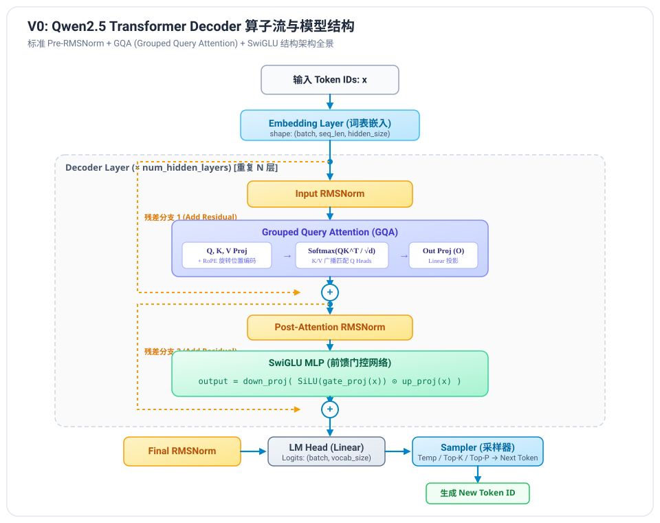
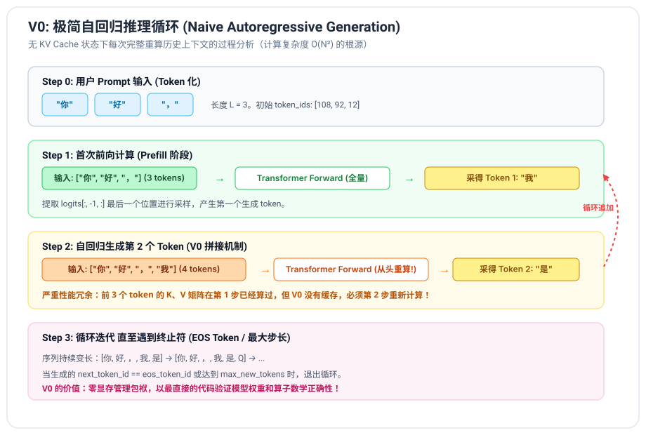

# V0 阶段笔记：极简自回归大模型推理引擎

---

## 1. V0 阶段目标与设计哲学

在学习和实现类似 vLLM 这样的复杂工业级大模型推理系统时，很多开发者容易一开始就陷入 PagedAttention、CUDA Graph、连续批处理（Continuous Batching）等多维度的复杂细节中。

**V0 的核心思想是：“不破不立，先跑通最简单的端到端闭环。”**
- **零显存池负担**：暂不引入复杂的物理分页显存池；
- **零缓存依赖**：不使用 KV Cache，自回归每一步直接把之前生成的全部 tokens 拼接后全量送入网络（Naive Concat）；
- **核心算子纯手写**：从底层张量运算手写 RMSNorm、RoPE、GQA、SwiGLU，不调用 `transformers` 内部的 forward 函数；
- **真实权重加载**：直接解析官方 `safetensors` 文件并载入模型，在 Greedy 采样下验证与 HuggingFace 官方输出的**比特级一致性**。

---

## 2. 模型架构拆解与算子原理

以目前工业界最主流的开源模型架构（以 **Qwen2 / Qwen2.5** 为代表）为例，它采用标准的 **Decoder-Only** 架构，并包含了当代大模型必备的核心现代化设计：

### 2.1 RMSNorm (Root Mean Square Normalization)
传统 LayerNorm 需要先减去均值 $\mu$，再除以方差 $\sigma$：
$$\text{LN}(x) = \frac{x - \mu}{\sqrt{\sigma^2 + \epsilon}} \odot \gamma + \beta$$

研究表明，LayerNorm 的主要增益来自于**缩放不变性**而非中心化（减均值）。因此，**RMSNorm** 舍弃了均值计算，直接使用均方根进行缩放，大幅精简了算子计算量与访存：
$$\text{RMS}(x) = \sqrt{\frac{1}{d} \sum_{i=1}^{d} x_i^2 + \epsilon}$$
$$\text{RMSNorm}(x) = \frac{x}{\text{RMS}(x)} \odot \gamma$$
其中 $\gamma$ 为可学习的缩放权重参数（shape: `[hidden_size]`）。

### 2.2 RoPE (Rotary Position Embedding)
旋转位置编码将绝对位置信息通过旋转矩阵注入到 Query 和 Key 向量中，使得任意两个位置 $m$ 与 $n$ 之间的注意力内积只依赖于其相对距离 $m - n$。

将向量以 2 维为一组视作复数平面上的点：
$$q_{m, [2i, 2i+1]} = \begin{pmatrix} \cos(m \theta_i) & -\sin(m \theta_i) \\ \sin(m \theta_i) & \cos(m \theta_i) \end{pmatrix} \begin{pmatrix} q_{m, 2i} \\ q_{m, 2i+1} \end{pmatrix}$$
其中频率基数：
$$\theta_i = b^{-2i/d}, \quad i \in [0, d/2-1]$$
在 Qwen2.5 中，基数 $b$ 增大到了 $1,000,000$（甚至更高），以支持超长上下文（32k / 128k）。

### 2.3 GQA (Grouped Query Attention)
传统的 MHA（Multi-Head Attention）中，Q、K、V 的头数完全相同（$H_Q = H_{KV}$）。在长文本和并发场景下，KV 占用的显存极其庞大。
- **MHA**：$H_Q = H_{KV}$（计算快，但显存占用大）
- **MQA**：$H_{KV} = 1$（显存最小，但模型表达力受损）
- **GQA**：将 Q 分为若干组，每组共享 1 对 K 和 V。例如 Qwen2.5-0.5B 中 $H_Q = 14$，$H_{KV} = 2$，即每 7 个 Q 共享同一个 K 和 V 头。

计算时，通过 `torch.repeat_interleave` 将 K、V 的头数复制扩展到与 Q 一致后，再执行标准的 Scaled Dot-Product Attention：
$$\text{Attention}(Q, K, V) = \text{Softmax}\left(\frac{QK^T}{\sqrt{d_k}} + \text{Mask}\right) V$$

### 2.4 SwiGLU MLP
传统 MLP 采用两层线性加 ReLU/GELU：$\text{Linear}_2(\sigma(\text{Linear}_1(x)))$。
现代 LLM 普遍采用 **SwiGLU**（Swish-Gated Linear Unit）：
$$\text{SwiGLU}(x) = \text{down\_proj}\Big(\text{SiLU}(\text{gate\_proj}(x)) \odot \text{up\_proj}(x)\Big)$$
- `gate_proj` 产生门控信号，经 $\text{SiLU}(z) = z \cdot \text{sigmoid}(z)$ 激活；
- `up_proj` 产生升维特征；
- 两者逐元素哈达玛积 $\odot$ 后，再经 `down_proj` 降维回 `hidden_size`。

---

## 3. 自回归循环与采样器 (Autoregressive Loop & Sampler)

### 3.1 自回归生成流程
1. **输入处理**：Prompt 经 Tokenizer 编码为 `input_ids = [t_1, t_2, ..., t_L]`。
2. **前向推理**：模型前向得到整个序列的输出，取最后一个位置的隐藏状态计算 Logits：
   $$\text{logits} = \text{LM\_Head}(h_L) \in \mathbb{R}^{V}$$
3. **采样选择**：通过采样器（Sampler）根据概率分布选择出下一个 Token $t_{L+1}$。
4. **拼接迭代**：将 $t_{L+1}$ 拼接到序列末尾：`input_ids = [t_1, ..., t_L, t_{L+1}]`。
5. **终止判定**：若 $t_{L+1} == \text{EOS}$ 或达到用户设定的 `max_tokens`，退出循环。

### 3.2 采样策略（Temperature, Top-K, Top-P）
采样器负责将原始的 Logits 转换为下一个 Token 的离散索引：
1. **Temperature 缩放**：
   $$\tilde{z}_i = z_i / T$$
   - $T \to 0$：退化为 Greedy 贪心采样（只取最高分）；
   - $T > 1$：分布变平缓，增加回答的多样性与创意。
2. **Top-K 截断**：
   只保留概率最大的前 $K$ 个词，其余词的 Logits 置为 $-\infty$。
3. **Top-P (Nucleus) 截断**：
   计算累计概率，仅保留累计概率达到阈值 $P$（如 0.8 或 0.9）的候选词集合，其余置为 $-\infty$。
4. **Softmax 与多项式抽样**：
   对过滤后的 Logits 进行 Softmax 归一化为概率分布，再调用 `torch.multinomial` 采样出单个 Token ID。

---

## 4. 权重加载机制 (Safetensors)

传统 PyTorch 的 `.bin` / `.pt` 使用 Python `pickle` 反序列化，存在安全风险（可执行任意代码）且加载耗时高。
**Safetensors** 采用纯二进制存储：
- **文件头（Header）**：前 8 字节记录 JSON 长度，后续 JSON 包含张量名称、数据类型（如 BF16/FP16）、维度（shape）以及在文件中的二进制偏移量（offset）；
- **数据区（Buffer）**：紧跟文件头之后存放紧凑对齐的原始字节。
- **零拷贝映射（mmap）**：操作系统通过 `mmap` 直接将磁盘文件映射到虚拟内存，按需加载，加载速度可达数 GB/s。

---

## 5. V0 的核心缺陷：为什么需要 V1 (KV Cache)？

在 V0 的每一步循环中，我们都把包含所有历史 Token 的整个序列 `[t_1, ..., t_n]` 传入模型。
- **计算复杂度**：生成长度为 $N$ 的输出，总计算量为：
  $$\sum_{i=1}^{N} O(i^2) = O(N^3) \text{ 或注意力层 } O(N^2)$$
- **事实上的不必要性**：
  在因果注意力（Causal Attention）中，历史 Token 的 Key 和 Value 向量是**永远不会改变的**！第 $n$ 步计算只需要新生成的 Token $t_n$ 的 Query 向量去和所有的历史 Key、Value 做内积即可。

**这正是 V1 版本要解决的问题：引入 KV Cache，将单步 Decode 的时间复杂度从 $O(n)$ 降为 $O(1)$，总复杂度从 $O(N^2)$ 降为 $O(N)$。**
