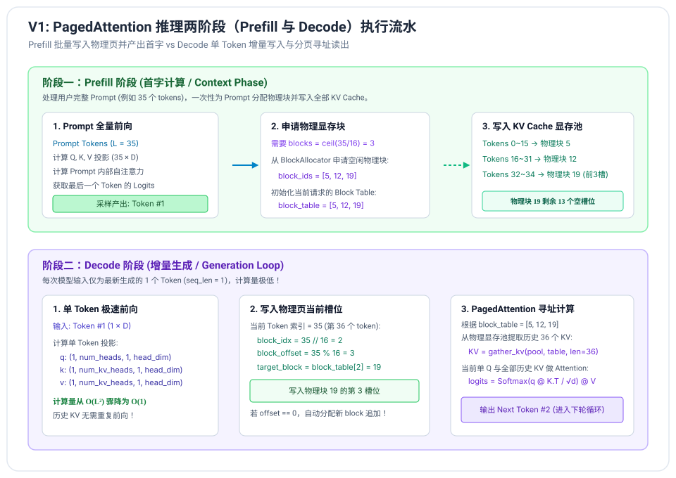

# V1 阶段笔记：KV 缓存与物理分页显存管理 (PagedAttention)

---

## 1. 为什么需要 KV Cache？

在自回归语言模型生成过程中，因果掩码（Causal Mask）保证了模型在计算第 $t$ 个位置的特征时，只能看到前面 $1 \sim t$ 个 Token 的信息，而看不到后面的 Token。

### 1.1 因果注意力的数学不变性
回顾标准缩放点积注意力公式：
$$\text{Attention}(Q_t, K_{\le t}, V_{\le t}) = \text{Softmax}\left(\frac{Q_t K_{\le t}^T}{\sqrt{d_k}}\right) V_{\le t}$$

请注意观察：
- 对于前面的历史 Token $i < t$，$K_i$ 和 $V_i$ 仅取决于前文输入，**其数值在后续生成步中绝对不会发生任何改变**！
- 在 V0 版本中，我们每生成一个新 Token，就把整个包含前文的序列重新传入模型从头算一遍。
  若最终生成 $N$ 个 Token，整个序列经历的前向计算量为：
  $$\sum_{i=1}^{N} O(i) = O(N^2)$$
  这导致了巨大的算力冗余与延迟陡增。

### 1.2 KV Cache 的核心原理
如果我们把前文计算得到的 $K_{\le t}$ 和 $V_{\le t}$ 保存在显存中，那么在生成下一个 Token $t+1$ 时：
1. **只需传入单个新 Token**（输入维度为 $1 \times d$）；
2. 线性投影仅计算当前 Token 的 $q_{t+1}, k_{t+1}, v_{t+1}$；
3. 将 $k_{t+1}, v_{t+1}$ 追加到缓存中，形成 $K_{\le t+1}, V_{\le t+1}$；
4. 当前单个 $q_{t+1}$ 与完整的 $K_{\le t+1}$ 做内积并对 $V_{\le t+1}$ 加权。

**单步计算复杂度直接从 $O(t)$ 降为 $O(1)$，总复杂度从 $O(N^2)$ 降为 $O(N)$。**

---

## 2. 传统 KV Cache 显存分配的致命缺陷

虽然 KV Cache 理念简单，但在 vLLM 诞生之前，业界框架（如原生 Hugging Face、FasterTransformer 等）对 KV Cache 的显存管理极其粗放：


### 2.1 静态连续显存预分配
因为不知道一个请求会回答多少个 Token（可能 10 个，也可能达到最大上限 2048/4096），系统只能为每个请求一次性开辟最大可能长度的**连续显存空间**：
$$\text{Memory} = 2 \times \text{num\_layers} \times \text{num\_kv\_heads} \times \text{max\_seq\_len} \times \text{head\_dim} \times \text{sizeof(dtype)}$$

### 2.2 两大显存碎片杀手
1. **内部碎片（Internal Fragmentation）**：
   - 用户提问只生成了 100 个 Token，但系统预占了 2048 个 Token 的显存空间。
   - 剩余 1948 个位置的显存完全被闲置（浪费高达 60% ~ 90%），但其他并发请求无法使用这部分空间。
2. **外部碎片（External Fragmentation）**：
   - 由于显存要求必须是物理连续的，不同请求在不同时刻创建和释放，导致显存空间出现大量不连续的“空洞”。即使总剩余显存充足，也无法容纳一个需要大块连续空间的新请求。

### 2.3 结论
**显存被严重浪费，导致推理引擎能支持的并发 Batch Size 极小，GPU 算力利用率极低。**

---

## 3. vLLM 的核心创新：PagedAttention 机制

PagedAttention 灵感直接来源于**现代操作系统的虚拟内存分页管理（Virtual Memory Paging）**：

| 操作系统虚拟内存 | vLLM PagedAttention |
| :--- | :--- |
| **逻辑地址空间** | 每个请求连续的 Token 序列逻辑空间 (0, 1, 2, ..., seq_len-1) |
| **物理内存页 (Page)** | 固定大小的物理显存块 (**Block**)，如包含 16 或 32 个 Tokens |
| **页表 (Page Table)** | 请求持有的逻辑块到物理块映射表 (**Block Table**) |
| **按需分配 (Demand Paging)** | 生成过程中，仅在当前 Block 写满时才向显存池申请下一个物理 Block |
| **写时复制 (Copy-on-Write)** | 前缀缓存 (Prefix Caching) 多请求共享 Prompt 块，写时分离 |

### 3.1 物理显存池 (GPU Memory Pool)
在引擎启动时，一次性在 GPU 显存上分配固定大小的物理张量池：
```python
# key_cache / value_cache
# shape: (num_blocks, num_kv_heads, block_size, head_dim)
key_cache = torch.empty((num_blocks, num_kv_heads, block_size, head_dim), dtype=dtype, device=device)
value_cache = torch.empty((num_blocks, num_kv_heads, block_size, head_dim), dtype=dtype, device=device)
```
- `num_blocks`：根据剩余可用显存一次性划定（例如几千甚至上万块）；
- `block_size`：通常取 16 或 32，小颗粒度极大消除了内部碎片（仅最后一个块存在平均小于 8 个 Token 的碎片，显存浪费率降至 4% 以下）。

### 3.2 块分配器 (BlockAllocator)
`BlockAllocator` 内部维护一个空闲链表/栈（`free_blocks: List[int]`）以及引用计数表（`ref_counts: Dict[int, int]`）：
- `allocate()`: 从 `free_blocks` 弹出一个空闲物理块 ID；
- `free(block_id)`: 引用计数减 1，当计数归 0 时回收回 `free_blocks`；
- 支持为 Prefix Caching 提供零拷贝复用。

### 3.3 逻辑块与物理块映射 (Block Table)
每个请求对应一个 `BlockTable`，记录逻辑块索引与物理块 ID 的映射：
```text
Token Index:    0  ... 15 | 16 ... 31 | 32 ... 47
Logical Block:      0     |     1     |     2
Physical Block:   #7      |    #2     |    #11
```
当生成新 Token 时：
1. 逻辑索引 `logical_block_idx = token_idx // block_size`；
2. 块内偏移 `block_offset = token_idx % block_size`；
3. 若 `block_offset == 0`，代表上一个块已满，从 Allocator 申请新物理块追加进 `block_table`；
4. 物理写入槽位：`physical_block_id = block_table[logical_block_idx]`。

---

## 4. 推理的两阶段流水：Prefill 与 Decode



### 4.1 Prefill 阶段（首字生成 / Context Phase）
- **输入**：用户完整 Prompt（长度 $L$）；
- **操作**：
  1. 计算所需物理块数 $\lceil L / \text{block\_size} \rceil$，向 `BlockAllocator` 申请物理块并建立 `block_table`；
  2. 模型前向计算 Q, K, V；
  3. 将 $L$ 个 Token 的 K、V 按槽位映射批量写入对应的物理显存块中；
  4. 对 Prompt 内部计算全量因果注意力，取最后位置输出 Logits，采样产生第一个生成 Token。

### 4.2 Decode 阶段（增量迭代 / Generation Loop）
- **输入**：仅最新生成的 1 个 Token（长度为 1）；
- **操作**：
  1. 计算当前新 Token 的 $q, k, v$；
  2. 确定其在物理显存中的写入槽位：若当前 Block 已满，自动申请新物理块追加到 `block_table`；
  3. 将新的 $k, v$ 写入显存池槽位；
  4. **PagedAttention 读取**：依据 `block_table` 从物理显存池中取出该请求的所有历史 K 和 V，与当前单个 $q$ 进行注意力计算；
  5. 产出下一个 Token，循环迭代直至触发停止条件；
  6. **释放资源**：请求结束时，归还 `block_table` 中的所有物理块至分配器。

---

## 5. 显存开销公式推导（面试精要）

以 Qwen2.5-0.5B 为例：
- `hidden_size` = 896
- `num_attention_heads` = 14
- `num_key_value_heads` = 2
- `head_dim` = 896 / 14 = 64
- `num_hidden_layers` = 24
- 数据类型：`bfloat16`（每个参数/数据占用 2 字节）

**每个 Token 在所有 Transformer 层占用的 KV Cache 大小**：
$$\begin{aligned}
\text{KV\_per\_token} &= 2 \times \text{num\_layers} \times \text{num\_kv\_heads} \times \text{head\_dim} \times \text{bytes\_per\_elem} \\
&= 2 \times 24 \times 2 \times 64 \times 2\text{ Bytes} \\
&= 12,288\text{ Bytes} \approx 12\text{ KB/Token}
\end{aligned}$$

对比传统方案：
- 若最大上下文设置为 32,768 tokens，单请求预分配需要：
  $$32768 \times 12\text{ KB} \approx 384\text{ MB}$$
  十几个并发请求就能将 16GB 显卡挤爆！
- 而在 PagedAttention 中，若用户请求总长仅 200 tokens，实际显存占用仅：
  $$200 \times 12\text{ KB} \approx 2.4\text{ MB}$$
  **显存节省了 160 倍！**
