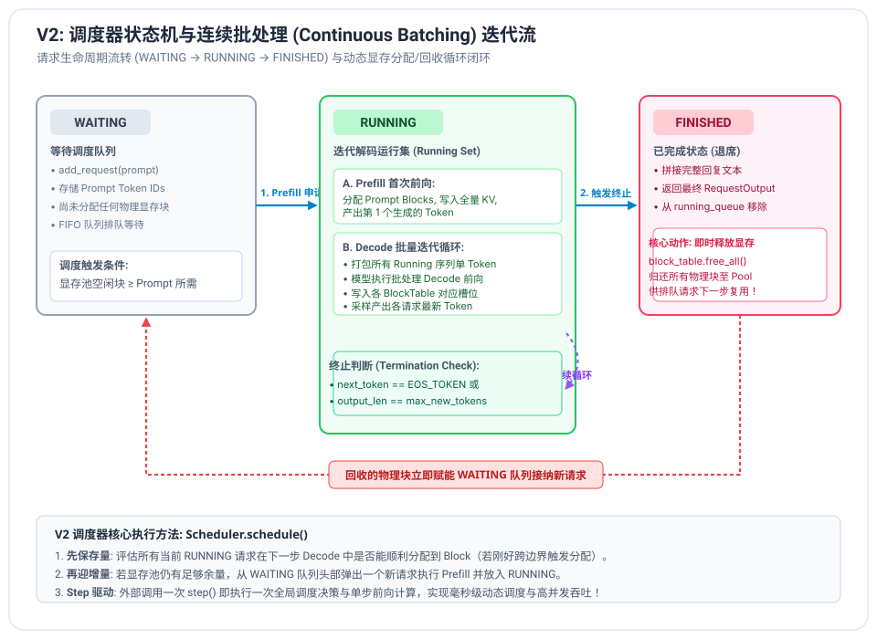

# V2 阶段笔记：连续批处理与并发调度器 (Continuous Batching)

---

## 1. 为什么需要连续批处理 (Continuous Batching)？

在工业级线上推理服务中，用户的请求是**异步、随机、长短不一**到达的。例如：
- 请求 A 只需回答一个单词（“是的”，生成 2 个 Token）；
- 请求 B 需要写一篇长篇报告（生成 1000 个 Token）；
- 请求 C 在 A 刚开始生成后 5 毫秒到达。


### 1.1 传统静态批处理（Static Batching）的木桶死锁
传统深度学习框架（如早期的 PyTorch / TensorRT 原生推理）采用**请求级批处理（Request-level Batching）**：
1. 必须等到攒够一个 Batch 的请求（如 4 个请求）才一起启动；
2. 为了矩阵维度对齐，必须将所有请求向最长的那个请求看齐，用大量无意义的 `<pad>` 填充；
3. **木桶效应极其恶劣**：请求 A 在第 2 步就已经生成完毕，但由于请求 B 需要生成 1000 步，请求 A 的显存和并发槽位被强制锁定 998 步，期间进行毫无意义的 Padding 计算；
4. **新请求无法及时进入**：排队中的请求 C 必须苦苦等待整个批次的所有请求全部结束，才能进入下一轮静态 Batch。

### 1.2 连续批处理（Continuous Batching）的核心突破
2022 年 OSDI 经典论文 **Orca** 提出了**迭代级批处理（Iteration-level Scheduling / Continuous Batching）**，并被 vLLM / SGLang 发扬光大：
- **调度粒度下沉至单步迭代（Step-level）**：
  模型不再以“完整请求”为单位调度，而是以**“每一个 Token 的生成步（Step）”**为单位动态调度；
- **即走即退，即来即进（Zero Bubbles）**：
  - 任何一个请求生成了 EOS 结束符，在该 Step 结束后**立即宣告完成，就地释放显存块**；
  - 只要显存池有足够空闲物理块，就绪的排队新请求在**下一个 Step 可以立刻插队进场执行 Prefill**！
- **GPU 算力满载**：无论长短请求如何穿插交织，GPU Tensor Core 始终保持在高密度利用率状态，系统吞吐可暴增 3x ~ 5x 以上！

---

## 2. 请求状态机与生命周期设计

在 vLLM 核心设计中，每个推理任务被封装为独立的序列对象（`Sequence`），并在清晰的状态机中流转：



### 2.1 三大核心生命周期状态
```text
      ┌───────────┐
      │  WAITING  │ ──► [新请求入队，尚未分配物理显存]
      └─────┬─────┘
            │  调度器检测显存充足，分配 Prompt 物理块并执行 Prefill
            ▼
      ┌───────────┐
      │  RUNNING  │ ◄──► [每步打包 Decode，追加 1 Token，检查显存]
      └─────┬─────┘
            │  触发 EOS 终止符 或 达到 max_new_tokens
            ▼
      ┌───────────┐
      │ FINISHED  │ ──► [拼接完整回答，即刻 free_all() 归还所有物理块]
      └───────────┘
```

### 2.2 状态属性定义
| 属性字段 | 类型 | 说明 |
| :--- | :--- | :--- |
| `seq_id` | `int` | 全局自增唯一标识符 |
| `prompt_token_ids` | `List[int]` | 用户输入的初始 Prompt Token 序列 |
| `output_token_ids` | `List[int]` | 已自回归生成的 Token 序列 |
| `block_table` | `BlockTable` | 当前请求独占的物理显存块映射表 |
| `status` | `SequenceStatus` | 当前所处状态（`WAITING` / `RUNNING` / `FINISHED`） |
| `sampling_params` | `SamplingParams` | 当前请求特定的超参数（Temperature、Top-P、Top-K 等） |

---

## 3. 调度器决策逻辑 (Scheduler Algorithm)

调度器的核心方法是 `Scheduler.schedule() -> SchedulerOutputs`，在每一次引擎迭代 `LLMEngine.step()` 时被调用。

其决策严格遵循两大黄金准则：

### 准则一：先保存量（Protect Running Sequences）
- 正在生成回复的请求具有最高优先级，不能轻易中断；
- 检查当前处于 `RUNNING` 状态的所有请求：
  - 评估每个请求在下一步生成新 Token 时，是否会触发新 Block 的申请（即 `num_tokens % block_size == 0`）；
  - 统计所有 RUNNING 请求下一步总共需要的新物理块数 `num_blocks_needed`；
  - 若 `allocator.get_num_free_blocks() < num_blocks_needed`，说明显存即将爆满，必须触发保护策略（如暂停新请求，或者将部分 RUNNING 请求抢占挂起）。

### 准则二：再迎增量（Admit Waiting Sequences）
- 在确保存量安全后，计算剩余可用物理块数 `available_blocks`；
- 按 FIFO 顺序审查 `WAITING` 队列头部的待处理请求：
  - 计算该请求 Prompt 所需的物理块数：$\lceil \text{prompt\_len} / \text{block\_size} \rceil$；
  - 若 `available_blocks` 充足，将其从 `WAITING` 弹出，分配物理块，放入本轮执行计划，并标记为 `RUNNING`；
  - 否则保留在队列中等待下个迭代。

---

## 4. 多请求批处理解码（Batch Decode）在 Paged KV Cache 下的实现

在 V1 中，我们的注意力算子只针对单个请求（`batch_size = 1`）。
在 V2 中，多个不同请求同时处于 Decode 状态，组成一个 **Decode Batch**：

### 4.1 输入张量与上下文规整
- **输入 Token IDs**：`input_ids: (B, 1)`，其中 $B$ 为当前并行运行的请求数，每一行代表对应请求最新生成的 1 个 Token；
- **位置编码**：`position_ids: (B, 1)`，每个请求根据自身的全局累计长度 `total_seq_len - 1` 单独计算绝对位置；
- **槽位映射**：每个请求计算各自写入当前 Block 的槽位；
- **注意力计算**：
  - 线性投影同时对 $B$ 个 Token 计算 $Q, K, V$；
  - 将每个请求新生成的 $k_b, v_b$ 分别写入其对应的物理块槽位；
  - 对每个请求 $b \in [0, B-1]$，分别从其对应的 `block_table` 聚集其独有的历史全部 KV，计算单 Query 对完整历史 KV 的注意力；
  - 产出 $B$ 个请求的 Logits，分别独立采样。

---

## 5. 为什么高并发能数十倍摊薄 CPU Launch 开销？

我们在 V1 笔记中通过 PyTorch Profiler 发现：
- GPU 实际执行前向计算仅需几十毫秒；
- 但 Python 解释器在 CPU 端循环遍历 24 个 Transformer 层、发射几百个底层 CUDA Kernel 的调度时间高达数秒！
- **当 Batch Size = 1 时**：CPU 发射 1 次 Kernel，GPU 只计算 1 个 Token 的数据，GPU 大部分时间在“饥饿等待”CPU；
- **当 Batch Size = 16 时**：CPU **依然只发射 1 次 Kernel**，但 GPU Tensor Core 在同一指令下并行处理 16 个 Token 的矩阵运算！
- **结论**：CPU 的 Launch Overhead 被 16 个请求均摊，每个 Token 分摊到的调度时间降为原来的 $\frac{1}{16}$，系统吞吐实现数倍爆发！
