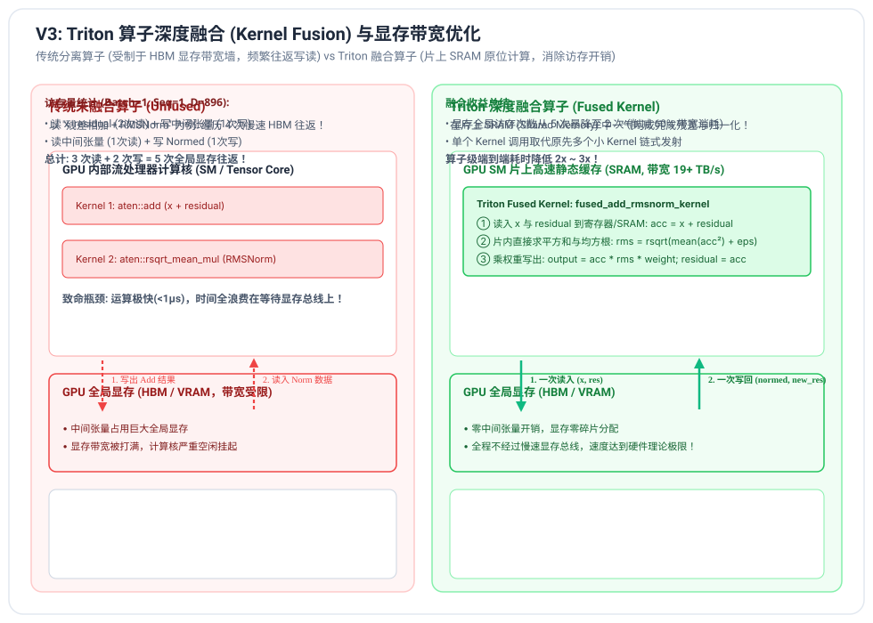
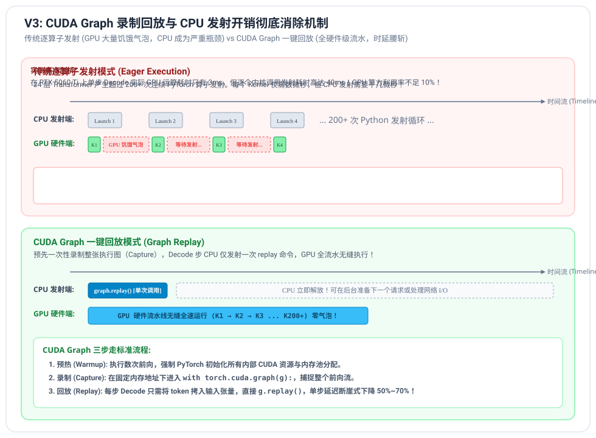

# V3 阶段笔记：单卡算子深度融合与 CUDA Graph 优化

---

## 1. 大模型推理的性能瓶颈分析：Memory-bound 与 Launch Overhead

在大模型（LLM）推理系统中，性能瓶颈在不同阶段截然不同：

### 1.1 计算密集型 vs 访存密集型
- **Prefill 阶段（首字计算）**：
  - 输入通常为数百至上千个 Token，计算形式为大矩阵乘法（GEMM）；
  - 算术强度（FLOPs / Byte）极高，属于典型的 **Compute-bound（计算受限型）**；
  - 此时充分利用 GPU Tensor Core 的浮点算力是首要目标。
- **Decode 阶段（逐字生成）**：
  - 每一步输入仅为 1 个 Token（或少量 Batch），计算形式为向量-矩阵乘法（GEMV）；
  - 算术强度极低，模型权重必须完整从全局显存（HBM）搬运到片上计算核，属于典型的 **Memory-bound（访存受限型）**；
  - 此时**减少全局显存读写次数、提高显存带宽利用率**是核心优化方向。

### 1.2 框架发射开销（CPU Launch Overhead）
我们在 V1 和 V2 中通过 PyTorch Profiler 发现：
对于拥有 24 层的 Qwen2-0.5B 模型，单步 Decode 实际在 GPU 上的执行时间**不足 5 毫秒**，但 Python 解释器在 CPU 端循环遍历 24 个 Transformer 层、发射 200+ 个底层 CUDA Kernel 的调度时间高达数十毫秒！
**GPU 有超过 80%~90% 的时间在“饥饿等待”CPU 发射下一个指令。**

**V3 的两大杀手锏正是为了彻底消灭这两大瓶颈：**
1. **Triton 算子深度融合**：消灭多次 HBM 往返，突破 Memory-bound 访存墙；
2. **CUDA Graph 捕获与回放**：消灭 CPU 逐算子发射，将 Launch Overhead 降至趋近于 0！

---

## 2. Triton 算子深度融合 (Kernel Fusion)



### 2.1 Fused RMSNorm + Residual (残差与归一化融合)
在 Transformer Decoder 中，每个子层（Self-Attention 和 MLP）之后都跟着一个残差相加（Residual Add），紧接着是下一个子层的输入归一化（RMSNorm）：
$$x_{\text{next}} = \text{RMSNorm}(x + \text{residual})$$

#### 传统 PyTorch 未融合模式：
1. 调用 `aten::add(x, residual)`：从 HBM 读取 $x$ 和 $\text{residual}$，写回中间张量到 HBM；
2. 调用 `aten::mean/rsqrt/mul`：再次从 HBM 读入刚才写出的中间张量，计算归一化，再写回 HBM。
**总计产生 3 次读 + 2 次写 = 5 次慢速 HBM 往返！**

#### Triton Fused RMSNorm 模式：
- 单个 Kernel 一次性将 $x$ 和 $\text{residual}$ 加载到 GPU 线程块的**片上高速静态寄存器 / 共享内存（SRAM，带宽超过 19 TB/s）**中；
- 在片内寄存器直接完成：
  $$\text{acc} = x + \text{residual}$$
  $$\text{rms} = \frac{1}{\sqrt{\frac{1}{d} \sum_{i} \text{acc}_i^2 + \epsilon}}$$
  $$\text{output} = \text{acc} \odot \text{rms} \odot \gamma$$
- 将计算好的 $\text{output}$ 与更新后的残差写回全局显存。
**访存往返从 5 次暴降为 2 次，显存带宽消耗降低 60%，算子耗时降低 2x 以上！**

### 2.2 Fused SwiGLU (门控激活融合)
传统前馈网络中：
$$\text{SwiGLU}(x) = \text{down\_proj}\Big(\text{SiLU}(\text{gate\_proj}(x)) \odot \text{up\_proj}(x)\Big)$$
中间经历了 `sigmoid`、`mul`、`mul` 等多个细碎元素级算子。
通过 Triton 编写融合 Kernel，单次载入 `gate` 与 `up`，在寄存器中直接计算：
$$y = (g \cdot \sigma(g)) \cdot u$$
极大减少了 GPU 内核启动次数与临时显存申请。

---

## 3. Triton PagedAttention 解码内核

在 V1/V2 中，我们通过 Python 端 `pool[block_table]` 高级切片从物理显存池抽取历史 KV。这种方式会触发多次中间张量分配与 Python 索引开销。

### 3.1 Triton PagedAttention Kernel 架构
- **Grid 划分**：`grid = (batch_size, num_heads)`；
- 每个 GPU 线程块负责单个序列的单个 Query Head；
- 线程块持有当前 Token 的单个 $Q$ 向量（存放在片上寄存器）；
- **跨 Block 寻址循环**：
  线程块根据 `block_table_ptr`，每次加载 1 个物理块（包含 `block_size` 个历史 Token 的 $K$ 和 $V$）；
- **在线 Softmax (Online Softmax)**：
  参考 FlashAttention 经典数学重标度技巧，在遍历物理块的过程中动态维护局部最大值 $m$ 和归一化分母 $l$：
  $$m_{\text{new}} = \max(m_{\text{old}}, \max(S))$$
  $$P = \exp(S - m_{\text{new}})$$
  $$l_{\text{new}} = l_{\text{old}} \cdot \exp(m_{\text{old}} - m_{\text{new}}) + \sum P$$
  $$O_{\text{new}} = O_{\text{old}} \cdot \exp(m_{\text{old}} - m_{\text{new}}) + P \cdot V$$
- 循环结束时，只需计算 $O / l_{\text{new}}$ 并直接写入最终输出张量。
**整个注意力过程完全在 GPU 片上完成，彻底剔除了 Python 层的切片与拷贝！**

---

## 4. CUDA Graph 录制回放与 CPU 发射开销归零



### 4.1 核心原理
在自回归 Decode 阶段，只要处于固定 Batch Size（例如 $B=1$ 或 $B=8$），每一次单步前向的计算特征极其独特：
- 输入 Tensor 形状恒为 `(B, 1)`；
- 每一层的权重地址完全固定；
- 算子依赖关系（DAG 拓扑）完全静态；
- 调用的底层 CUDA Kernel 序列完全确定。

### 4.2 CUDA Graph 三步走工程化
1. **预热阶段 (Warmup)**：
   在固定的静态输入/输出 Buffer 上运行 2~3 次前向传播，让 PyTorch 的内部缓存分配器（Caching Allocator）和 CUDA Driver 完成全部静态内存绑定。
2. **捕获阶段 (Capture)**：
   ```python
   graph = torch.cuda.CUDAGraph()
   with torch.cuda.graph(graph):
       static_logits = model(static_input_ids, context=static_context)
   ```
   CUDA Driver 会将这数以百计的内核调用及其参数一次性固化在 GPU 硬件调度队列中。
3. **回放阶段 (Replay)**：
   在实际的每一步 Decode 中：
   ```python
   # 1. 仅将新 Token ID 拷贝进静态输入张量
   static_input_ids.copy_(curr_token_id)
   # 2. 单次 CPU 指令回放整张图！
   graph.replay()
   # 3. 从静态输出中读取结果
   ```
**CPU 发射开销瞬间从数十毫秒暴跌至趋近于 0（< 10 微秒），GPU 算力利用率拉满！**
