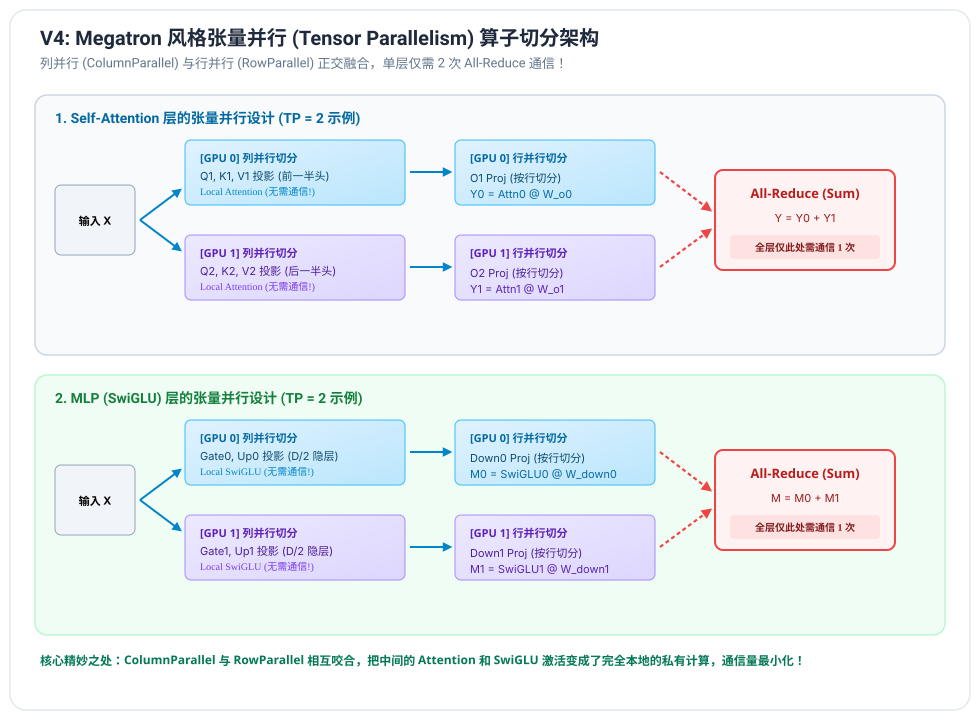
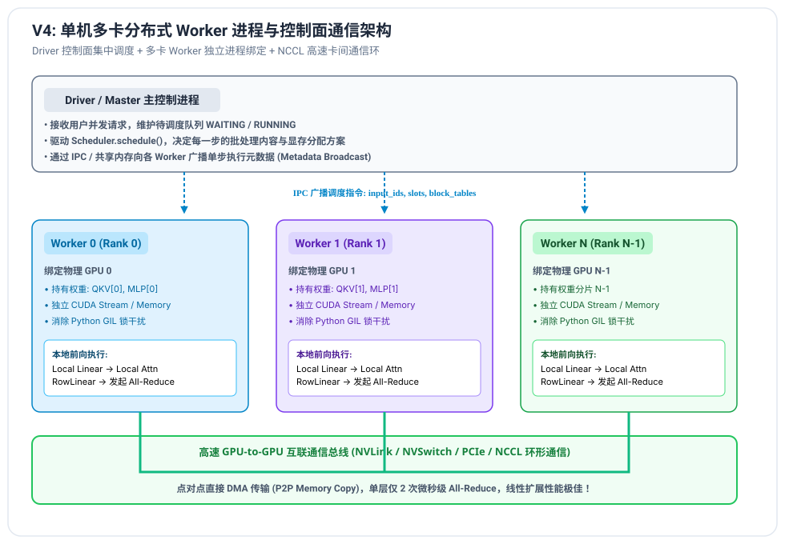

# V4 阶段笔记：单机多卡张量并行 (Tensor Parallelism)

---

## 1. 为什么需要张量并行 (Tensor Parallelism)？

当大模型的参数量突破单张显卡的显存上限（例如 70B 模型以 16-bit 载入需要 140GB 纯权重显存，加上 KV Cache 至少需要数百 GB 显存），单张 GPU 物理上已无法容纳。

### 1.1 三大主流并行策略对比
| 并行策略 | 切分维度 | 通信原语 | 适用场景与优缺点 |
| :--- | :--- | :--- | :--- |
| **数据并行 (DP)** | 批处理大小 (Batch) | All-Reduce (梯度) | 训练为主。推理时无法解决单请求显存装不下大模型的问题。 |
| **流水线并行 (PP)** | 模型层数 (Layers) | P2P (Send/Recv) | 跨机跨节点。层与层之间存在天然气泡（Pipeline Bubbles），长文本延迟高。 |
| **张量并行 (TP)** | 权重矩阵维度 (Heads / Hidden) | All-Reduce | **单机多卡推理首选（高速 NVLink/PCIe 互联）**。单 Token 解码延迟极低，零气泡！ |

---

## 2. Megatron-LM 经典张量并行切分范式

Megatron-LM 的核心智慧在于：**巧妙地将列并行与行并行按序咬合，使得层内的核心复杂激活计算完全无需卡间通信！**

### 2.1 列并行线性层 (ColumnParallelLinear)
权重矩阵按列（输出特征维度）在各 GPU 间切分：
$$W = \begin{bmatrix} W_1 & W_2 & \dots & W_k \end{bmatrix}$$
前向计算时：
- 输入 $X$ 在每张卡上是完全相同的（复制广播）；
- 每张卡独立计算局部的矩阵乘法：
  $$Y_i = X W_i$$
- **关键特性**：输出 $Y_i$ 正好对应当前卡持有的一部分特征/头，**不需要任何卡间通信！**
- **应用场景**：
  1. Attention 中的 $Q, K, V$ 投影：每张卡独立持有 $\frac{H}{TP}$ 个 Attention 头；
  2. MLP 中的 `gate_proj` 与 `up_proj`：每张卡独立持有 $\frac{D_{\text{inter}}}{TP}$ 个中间特征。

### 2.2 行并行线性层 (RowParallelLinear)
权重矩阵按行（输入特征维度）在各 GPU 间切分：
$$W = \begin{bmatrix} W_1 \\ W_2 \\ \dots \\ W_k \end{bmatrix}$$
前向计算时：
- 输入 $X = \begin{bmatrix} X_1 & X_2 & \dots & X_k \end{bmatrix}$，正好由上一级列并行算子的本地输出直接提供（无需通信重组！）；
- 每张卡独立计算局部的矩阵乘法：
  $$Y_i = X_i W_i$$
- 真正的最终输出是所有局部结果的数学累加：
  $$Y = \sum_{i=1}^{k} Y_i = \text{All-Reduce-Sum}(Y_i)$$
- **关键特性**：只需在输出处执行**单次 All-Reduce 集合通信**，即可恢复完整的隐藏状态向量！
- **应用场景**：
  1. Attention 中的 $O$ 投影（Out Projection）；
  2. MLP 中的 `down_proj`。

### 2.3 为什么每个 Transformer 块仅需 2 次 All-Reduce？
观察整个 Decoder Layer 的算子流：
1. `Input RMSNorm`（各卡输入相同，本地计算，零通信）；
2. `QKV Proj` (ColumnParallel) $\to$ 本地计算，零通信；
3. `Attention` 计算 $\to$ 各卡仅处理自己持有的头，本地计算，零通信；
4. `O Proj` (RowParallel) $\to$ **第 1 次 All-Reduce**（收集完整注意力输出）；
5. `Post-Attn RMSNorm`（各卡数据重新一致，本地计算，零通信）；
6. `Gate/Up Proj` (ColumnParallel) $\to$ 本地计算，零通信；
7. `SwiGLU` 激活 $\to$ 本地哈达玛积，零通信；
8. `Down Proj` (RowParallel) $\to$ **第 2 次 All-Reduce**（收集完整 MLP 输出）。

**无论模型多大、卡数多少，每层仅仅发生 2 次集合通信，通信开销被极致压缩！**

---

## 3. 多进程 Worker 架构设计与 GIL 解除

在真实的生产级系统（如 vLLM）中，单机多卡绝不能在一个 Python 进程中通过单线程轮询驱动：
- **Python GIL 锁瓶颈**：多卡共享同一个主线程会导致严重的 GIL 争抢；
- **CUDA Context 隔离**：每个物理 GPU 绑定一个独立的 OS 进程（`Worker`），拥有独占的 CUDA Context 和 Memory Allocator；
- **控制面与数据面解耦**：
  - **Driver 进程**：作为控制面，负责调度、词表编解码、HTTP 服务；
  - **Worker 进程**：作为执行面，监听调度指令，并行执行前向运算，卡间通过 NCCL 高速卡间通信总线（NVLink / PCIe）直通互联。
