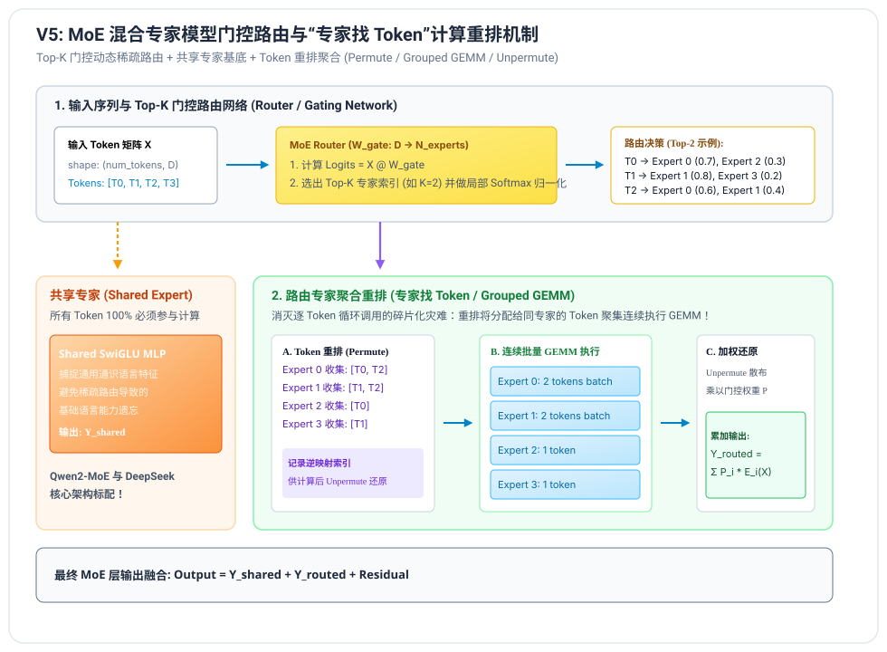
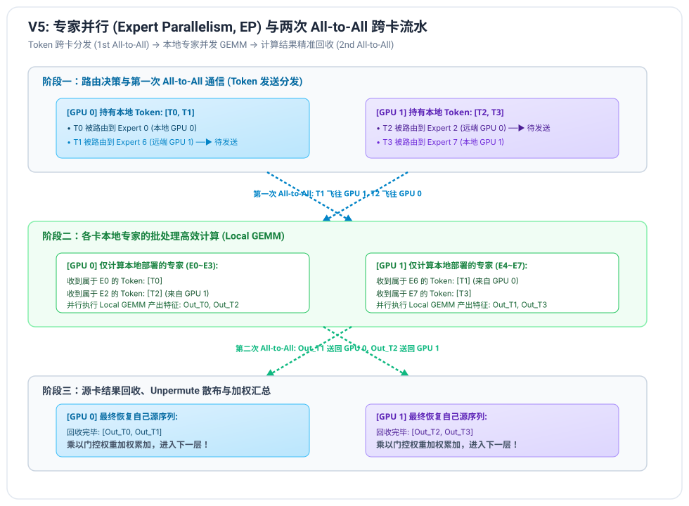

# V5 阶段笔记：MoE 混合专家模型与专家并行 (Expert Parallelism)

---

## 1. MoE 混合专家模型的发展脉络与核心动机

在 Scaling Law（大模型缩放定律）指导下，模型的参数量不断增大。然而对于传统的稠密大模型（Dense Model）：
$$\text{总参数量} = \text{每个 Token 激活的计算量}$$
模型参数增加到 70B 时，每个 Token 必须实打实计算 70B 参数的 FLOPs，导致计算成本与推理延迟急剧攀升。

### 1.1 稀疏混合专家模型 (Sparse MoE) 的破局点
现代 SOTA 模型（如 Qwen2-57B-A14B、DeepSeek-V2 / V3、Mixtral 8x7B）的核心设计思想是：
**“解耦模型容量与推理计算量！”**
- **模型总参数量极大（57B ~ 671B）**：可以承载数十倍于小模型的常识、代码和逻辑推理容量；
- **单 Token 激活参数量极小（14B ~ 37B）**：通过门控路由（Router），每个 Token 仅激活最擅长处理该特征的 Top-K 个专家（如 64 个专家中激活 6~8 个）；
- **推理速度与小模型相当，而回答质量逼近超大稠密模型！**

---

## 2. Top-K 门控路由网络与共享专家 (Router & Shared Experts)



### 2.1 门控路由算法数学推导
给定输入 Token 的隐藏向量 $x \in \mathbb{R}^{d}$，门控网络通过线性层计算所有 $N$ 个专家的原始得分（Logits）：
$$s = x \cdot W_{\text{gate}}, \quad s \in \mathbb{R}^{N}$$
1. **Top-K 选择**：
   找出得分最高的 $K$ 个专家集合 $\mathcal{K} = \text{TopK}(s, K)$；
2. **局部 Softmax 归一化**：
   对入选的 Top-K 专家的得分重新进行归一化，得到最终的门控概率权重 $p_i$：
   $$p_i = \begin{cases} \frac{\exp(s_i)}{\sum_{j \in \mathcal{K}} \exp(s_j)}, & i \in \mathcal{K} \\ 0, & i \notin \mathcal{K} \end{cases}$$

### 2.2 共享专家（Shared Expert）设计
在早期 MoE（如 Switch Transformer）中，所有专家都是稀疏路由的。这导致一些基础通用词汇（如标点符号、常用助词）在各个专家之间频繁摆动，容易造成知识碎片化。
现代主流架构（Qwen2-MoE 和 DeepSeek）引入了**共享专家（Shared Expert）**：
- 设立 1~2 个固定专家，**所有 Token 100% 必须经过共享专家计算**；
- 共享专家专注学习全局通识特征，路由专家专注学习领域垂直特征；
- 最终输出为两者的融合：
  $$\text{Output} = \text{Shared\_MLP}(x) + \sum_{i \in \mathcal{K}} p_i \cdot \text{Expert}_i(x)$$

---

## 3. 计算模式跃迁：从“Token 找专家”到“专家找 Token”

在大模型推理工程中，初学者常犯的致命错误是写出如下循环：
```python
# 错误示范：极其低效的 Token 找专家
for token, selected_experts in zip(tokens, routes):
    for exp_id in selected_experts:
        out += weights[exp_id] * experts[exp_id](token)
```
- 这会导致成千上万次 $1 \times d$ 的细碎小张量前向调用，GPU 算力利用率暴跌至 1% 以下！

### 3.1 工业级“专家找 Token”重排管线 (Permute & Grouped GEMM)
1. **重排阶段 (Permute / Binning)**：
   统计每个专家被分配到的所有 Token，将同一专家的 Token 聚集在一起，拼接成大块连续张量；同时记录逆映射索引；
2. **批量计算阶段 (Batched Experts GEMM)**：
   对每个专家执行单次批处理矩阵乘法（$M \times d$ 的密集 GEMM），完全释放 GPU Tensor Core 算力；
3. **散布还原阶段 (Scatter / Unpermute)**：
   根据逆映射索引将特征写回各个 Token 的原始位置，并乘以门控概率 $p_i$ 累加！

---

## 4. 专家并行 (Expert Parallelism, EP) 与两次 All-to-All



当专家数量达到几十甚至数百个时，单张 GPU 无法装下所有专家的权重。**专家并行（EP）将不同的专家分布在不同的 GPU 上**：
- 例如 8 个专家分布在 2 张卡上：GPU 0 持有 Expert 0~3，GPU 1 持有 Expert 4~7。

### 4.1 核心通信原语：两次 All-to-All 握手
1. **第一次 All-to-All（Token 跨卡分发）**：
   - 每张卡在本地 Router 判决出各 Token 的目标专家；
   - 若某 Token 被分配给属于远端 GPU 的专家，通过 `All-to-All` 通信将其发送给对应的目标卡；
2. **本地专家计算阶段**：
   - 各 GPU 仅负责执行本地部署专家的批处理运算，无需关心其他卡上的专家；
3. **第二次 All-to-All（特征结果回收）**：
   - 各 GPU 将计算好的专家输出特征通过 `All-to-All` 原路发回源 GPU；
   - 源卡收到所有属于自己 Token 的专家输出，乘以路由权重完成汇总！

### 4.2 TP 与 EP 混合并行
在实际大集群推理中，通常采用 **TP + EP 混合编排**：
- Attention 层采用张量并行（TP），按头切分；
- MoE MLP 层采用专家并行（EP），按专家切分；
- 这种复合架构最大化了多卡显存利用率与卡间通信吞吐！
